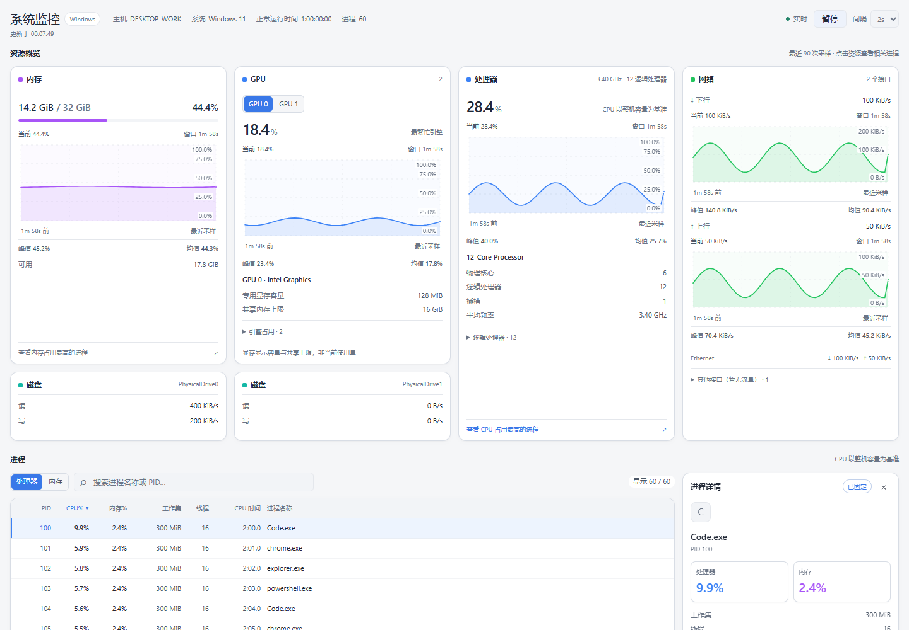
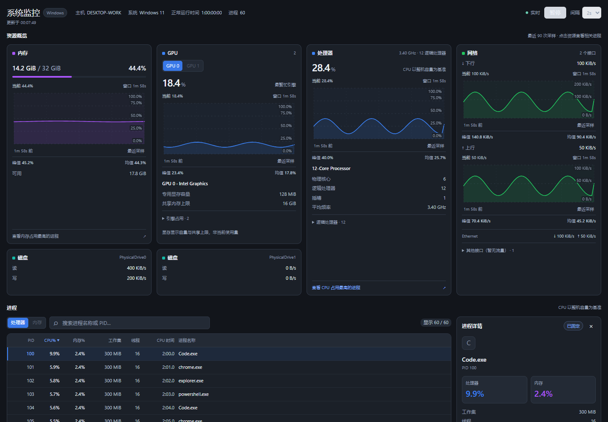

# System Monitor

[简体中文](README.md) | **English**

A DSH system monitoring plugin for **Windows 10 / Windows 11**. View CPU, GPU, memory, disk, network, and process activity in one page, with interactive history charts, live device updates, and process management.

Current version: **0.1.0**. Resource cards, interactive charts, responsive layouts, and process workflows are designed around everyday system monitoring, backed by a native collector, shared sampling service, and on-demand rendering.



<details>
<summary>View the dark theme</summary>



</details>

> Screenshots use browser test data. Actual readings come from your machine.

## Features

| Module | Metrics |
| --- | --- |
| CPU | Overall utilization, physical cores, logical processors, sockets, average frequency, and per-logical-processor utilization |
| GPU | Multiple GPU selection, live utilization, history, engine activity, model, and memory capacity |
| Memory | Used, total, and available capacity, utilization percentage, and history |
| Disks | Separate cards for each physical disk with live read and write rates |
| Network | Download and upload rates, history, active interfaces, and expandable idle interfaces |
| Processes | Name, PID, CPU and memory percentages, working set, thread count, and cumulative CPU time |

- **Interactive history**: Up to 90 samples with time range, current value, peak, and average. Inspect individual samples using a pointer, touch, or keyboard. Loading feedback appears during warmup, followed by a fade into real chart data.
- **Process browsing**: Filter by name or PID, sort by column, and browse with pagination and windowed rendering. CPU and memory cards can directly select the corresponding process sort order.
- **Live details**: Hover or focus to preview a process, click to pin its details, and press Esc to unpin. Pinned details continue updating.
- **Process management**: Confirm termination with a second click within 3 seconds. Process creation time is checked to prevent acting on a reused PID.
- **Live device updates**: Disks, network interfaces, GPUs, and CPU topology are enumerated during operation, and system-reported memory capacity is refreshed. New devices establish fresh rate baselines; removed devices disappear from the list.
- **Sampling controls**: Pause, resume, and choose a 1 / 2 / 5-second page refresh interval. Polling stops while the page is hidden, and the last snapshot remains available during a connection interruption.
- **Theme and accessibility**: Follows the host's light and dark themes, with Chinese and English interface text, keyboard interaction, and reduced-motion support.

## Layout and interaction

The layout follows the **plugin container width**, supporting full-screen, regular-window, and split-pane use:

| Container width | Resource layout |
| --- | --- |
| Above 1000px | Four columns: memory and GPU with disks below on the left, CPU and network on the right |
| Above 580px and up to 1000px | Two columns, prioritizing CPU and network |
| Up to 580px | One column |

In the collapsed wide layout, the outer edges of all four columns align vertically. Expanding logical processors or additional network interfaces does not stretch the content on the left. CPU tiles show four logical processors per row, and GPU engine activity can be expanded or collapsed. Narrow windows provide resource/process navigation; secondary process metrics remain available in the details panel.

## Installation and usage

### Requirements

- Windows 10 / Windows 11 **x64**.
- DSH **0.2.2-rc.1**, the version targeted by the current compatibility declaration.
- Node.js **24.9 or later** for the plugin backend and development tools.

The package includes a native x64 collector and has no npm runtime dependencies. Running the plugin does not require local compilation or an additional PowerShell or .NET runtime installation.

### Install from a local directory

With the `dsh` command configured, replace the path below with your project directory:

```powershell
dsh plugin --profile desktop add "C:/path/to/oh-dsh-plugin-system-monitor"
```

Fully quit and reopen DSH, then select **System Monitor** in the sidebar. For a standalone Web installation, use the `web` profile; restart `dsh web` if hot reload is not enabled.

Local installation links to the project directory, so keep that directory in place. Fully restart DSH once after updating the backend or native collector. Subsequent device connections and removals do not require reopening the page.

Uninstall:

```powershell
dsh plugin --profile desktop remove dsh-plugin-sysmon
```

## Understanding the data

- Native sampling runs approximately every **2 seconds**, independently of the page refresh interval. A 1-second refresh may retrieve the same snapshot more than once.
- The first snapshot can show capacities, device information, and the process list. CPU utilization, network rates, and disk rates require two samples to calculate deltas; GPU counters also need warmup. Loading feedback is shown while waiting, without generating simulated waveforms.
- Overall CPU and process CPU percentages use **100% for the machine's total processing capacity**. Each logical processor displays its own utilization separately.
- GPU utilization is the utilization of its busiest engine; parallel engines are not added together. Dedicated GPU memory shows capacity and shared memory shows its limit, **not current memory usage**.
- Charts use actual sample timestamps. Missing data creates gaps without zero filling or smoothing. Collector restarts, abnormal intervals, and relevant capacity changes rebuild the corresponding baselines or history.
- Live device updates reflect changes recognized by Windows. Display latency also depends on the refresh interval; memory capacity changes require hardware and operating system support.
- Disks represent physical devices rather than partitions. Devices remain visible when their performance counters are unavailable, with rates shown as `—`.
- Process fields that cannot be read are shown as `—`. Termination is forced and may discard unsaved work; protected targets or operations without sufficient permission are rejected.

Only Windows x64 builds are currently distributed. Windows 11 has been tested locally; Windows 10 has not yet been tested on physical hardware. Linux, macOS, and Windows Server are not supported.

## Architecture

```text
Windows system APIs
       ↓
Native C collector (approximately every 2 seconds)
       ↓ JSON samples
Shared Host sampling service
       ↓ Authenticated snapshot API
Resource panels · Interactive charts · Process list and details
```

The native collector enumerates devices and reads counters. The Host manages the collector lifecycle, calculates deltas, aggregates metrics, and maintains bounded history. The frontend handles polling, resource layouts, and process interaction.

Requests share one collector process rather than launching a system command for each request. The collector is released after approximately 6 seconds without snapshot requests and starts again when needed. Unloading releases routes, timers, child processes, and caches.

| Directory / file | Responsibility |
| --- | --- |
| `native/sysmon.c` | Native Windows collector source |
| `lib/native/win32-x64/` | Collector binary and build verification metadata |
| `lib/index.js` | Host sampling, metric calculations, authenticated APIs, and process operations |
| `src/client/` | Frontend modules, requests, resource cards, charts, process table, and styles |
| `lib/client.js` | Generated frontend module |
| `locale/` | Chinese and English plugin management metadata |
| `scripts/` | Builds, regression checks, and resource measurements |
| `docs/` | Design notes, development instructions, measurement records, and screenshots |

### APIs

Endpoints are registered through the host's authenticated channel:

| Endpoint | Behavior |
| --- | --- |
| `GET /api/sysmon.snapshot` | Returns a `v: 1` JSON snapshot with caching disabled; returns 503 when collection is unavailable |
| `POST /api/sysmon.kill` | Accepts `{ pid, signal: "KILL", start }` and verifies creation time before terminating the target |

Termination rejects the host, collector, and protected system processes. Identity verification and termination use the same process handle.

## Development and verification

Install development dependencies:

```powershell
npm ci --ignore-scripts
npm run test:setup
npx playwright install chromium
```

After editing `src/client/`, regenerate the frontend. Do not edit `lib/client.js` directly:

```powershell
npm run build:client
npm run check
npm test
```

After editing the native collector, build with MinGW-w64 GCC and run verification:

```powershell
# Optional: set CC to the path of gcc.exe
npm run build:native
npm test
```

The full suite covers generated output consistency, package contracts, delta calculations, collector recovery, device additions/removals and identifier reuse, native process behavior, page interaction, and responsive layouts. Hotplug coverage includes simulated regression scenarios; it does not establish physical hotplug compatibility for all hardware. Set `CHROME_EXE` to use a locally installed browser for browser tests.

Measure resource usage:

```powershell
npm run test:memory
```

The default duration is 60 seconds. Set `SYSMON_MEMORY_SECONDS` and `SYSMON_MEMORY_REPORT` to change the duration and report path. Measurements do not force garbage collection or trim working sets. Backend results do not include the exclusive rendering cost of a real DSH page. See the [resource measurement record (Chinese)](docs/MEMORY.zh-CN.md) for definitions and historical results.

## Project documentation

The detailed documents below are currently available in Chinese:

- [UI / UX design](docs/UI-UX.zh-CN.md)
- [Development and installation](docs/PLUGIN-DEVELOPMENT.zh-CN.md)
- [Resource measurement record](docs/MEMORY.zh-CN.md)

## License

This project uses the [MIT License](LICENSE) and retains the copyright and license notices distributed with the code.
