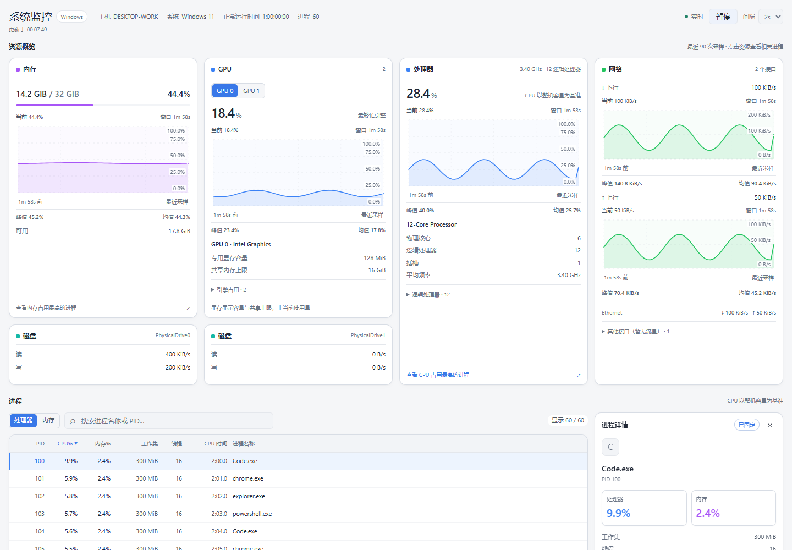
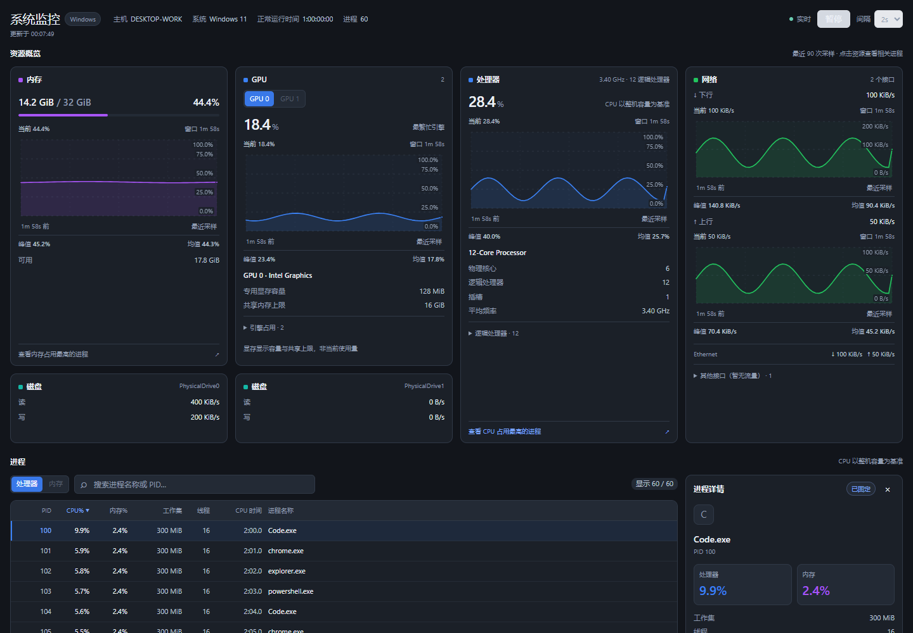

# System Monitor · 系统监控

**简体中文** | [English](README.en.md)

面向 **Windows 10 / Windows 11** 的 DSH 系统监控插件。在一个页面中查看 CPU、GPU、内存、磁盘、网络与进程状态，支持实时历史曲线、设备动态更新和进程管理。

当前版本 **0.1.0**。本项目围绕系统监控需求设计资源卡片、交互曲线、响应式布局与进程操作流程，采用原生采集器、共享后台采样和前端按需渲染实现。



<details>
<summary>查看深色界面</summary>



</details>

> 截图使用浏览器测试数据，实际指标以本机采集结果为准。

## 功能

| 模块 | 展示内容 |
| --- | --- |
| CPU | 整机利用率、物理核心、逻辑处理器、插槽、平均频率及各逻辑处理器占用 |
| GPU | 多 GPU 切换、实时利用率、历史趋势、引擎占用、型号和显存容量 |
| 内存 | 已用、总量、可用容量、使用比例与历史趋势 |
| 磁盘 | 每块物理磁盘独立展示，提供实时读写速率 |
| 网络 | 上下行速率、历史曲线、活跃接口与可展开的空闲接口 |
| 进程 | 名称、PID、CPU 占比、内存占比、工作集、线程数与累计 CPU 时间 |

- **交互历史曲线**：最多保留 90 个采样点，显示时间范围、当前值、峰值与均值；支持鼠标、触摸和键盘逐点查看。预热阶段提供加载动效，真实曲线就绪后淡入。
- **进程浏览**：按名称或 PID 筛选、点击列排序、分页与窗口化渲染；CPU 和内存卡片可直接联动进程排序。
- **实时详情**：悬停或聚焦预览进程，点击固定详情；固定后持续更新，按 Esc 取消。
- **进程管理**：结束操作需在 3 秒内再次点击确认，并校验进程创建时间，防止 PID 复用导致误操作。
- **设备动态更新**：运行期间重新枚举磁盘、网卡、GPU 与 CPU 拓扑，更新系统识别的内存容量；新增设备重新建立速率基线，移除后自动更新列表。
- **采样控制**：支持暂停、恢复及 1 / 2 / 5 秒页面刷新；页面隐藏时停止轮询，连接中断时保留最后一份快照。
- **主题适配**：跟随宿主浅色、深色主题，提供中英文文案、键盘交互及减少动态效果支持。

## 布局与交互

布局根据**插件容器宽度**调整，适用于全屏、普通窗口与分栏场景：

| 容器宽度 | 资源布局 |
| --- | --- |
| 大于 1000px | 四列：左侧内存、GPU 与下方磁盘，右侧 CPU、网络 |
| 大于 580px 且不超过 1000px | 两列，优先展示 CPU 与网络 |
| 不超过 580px | 单列排列 |

宽屏收起状态下四列外边缘保持等高；展开 CPU 逻辑处理器或其他网络接口时，不联动拉伸左侧内容。CPU 逻辑处理器每行四个块状占用指示，GPU 引擎占用支持展开和折叠。窄窗口提供资源区与进程区跳转，次要进程指标可在详情中查看。

## 安装与使用

### 环境要求

- Windows 10 / Windows 11 **x64**。
- DSH **0.2.2-rc.1**，当前兼容声明以该版本为准。
- Node.js **24.9 或更高版本**，用于插件后台运行及开发工具。

安装包包含原生 x64 采集器，无 npm 运行时依赖，使用时无需本机编译，也无需额外安装 PowerShell 或 .NET 运行环境。

### 本地目录安装

在已配置 `dsh` 命令的环境执行，将路径替换为项目所在目录：

```powershell
dsh plugin --profile desktop add "C:/path/to/oh-dsh-plugin-system-monitor"
```

完整退出并重新打开 DSH，在侧栏进入「系统监控」。独立 Web 环境将 profile 改为 `web`；未启用热更新时需重启 `dsh web`。

本地安装以目录链接方式加载，请保留项目目录。更新后台或原生采集器后，完整重启 DSH 一次；之后设备插拔无需重启页面。

卸载：

```powershell
dsh plugin --profile desktop remove dsh-plugin-sysmon
```

## 数据说明

- 原生采样周期约 **2 秒**，页面刷新间隔与采样周期独立。选择 1 秒刷新时，可能连续读取同一份快照。
- 首份快照可展示容量、设备信息和进程列表；CPU 利用率、网络及磁盘速率需要两次采样计算差值，GPU 计数器也需要预热。等待时显示加载状态，不生成模拟波形。
- CPU 与进程 CPU 占比均以**整机总算力为 100%**；各逻辑处理器单独显示自身占用。
- GPU 总利用率取该设备最繁忙引擎的占用，不叠加并行引擎。专用显存显示容量，共享内存显示上限，**不表示当前已用显存**。
- 历史图按实际采样时间绘制，缺失数据保持断点，不补零或平滑。采集器重启、异常时间间隔及相关容量变化会重建对应基线或历史。
- 热更新以 Windows 已识别的设备变化为准，显示延迟还取决于页面刷新间隔；内存容量变化需要硬件和系统支持。
- 磁盘按物理设备展示，不把分区数量当作磁盘数量。计数器不可用时仍保留设备，速率显示 `—`。
- 无权限读取的进程字段显示 `—`。结束进程是强制终止，可能丢失未保存的数据；受保护或权限不足的目标会被拒绝。

当前仅发布 Windows x64 构建；Windows 11 已完成本机验证，Windows 10 尚未实机验证。不支持 Linux、macOS 或 Windows Server。

## 架构

```text
Windows 系统接口
       ↓
原生 C 采集器（约 2 秒一次）
       ↓ JSON 样本
共享 Host 采样服务
       ↓ 认证快照接口
资源面板 · 交互曲线 · 进程列表与详情
```

原生采集器负责设备枚举与计数器读取；Host 负责采集器生命周期、差值计算、指标聚合与有界历史；前端负责数据轮询、资源布局和进程交互。

多个请求共享一个采集进程，不为每次请求启动系统命令。无快照请求约 6 秒后释放采集进程，再次查看时自动启动；卸载时释放路由、定时器、子进程和缓存。

| 目录 / 文件 | 职责 |
| --- | --- |
| `native/sysmon.c` | 原生 Windows 采集器源码 |
| `lib/native/win32-x64/` | 采集器二进制与构建校验信息 |
| `lib/index.js` | Host 采样、指标计算、认证接口与进程操作 |
| `src/client/` | 前端模块、数据请求、资源卡片、曲线、进程表与样式 |
| `lib/client.js` | 由前端源码生成的加载产物 |
| `locale/` | 插件管理页中英文元数据 |
| `scripts/` | 构建、回归验证与资源测量 |
| `docs/` | 设计说明、开发说明、资源测量记录与截图 |

### 接口

接口通过宿主认证通道注册：

| 接口 | 行为 |
| --- | --- |
| `GET /api/sysmon.snapshot` | 返回 `v: 1` JSON 快照，禁用缓存；采集不可用时返回 503 |
| `POST /api/sysmon.kill` | 接收 `{ pid, signal: "KILL", start }`，校验创建时间后结束目标 |

结束操作拒绝宿主、采集器及受保护的系统进程，并在同一个进程句柄上完成身份校验与终止。

## 开发与验证

准备开发依赖：

```powershell
npm ci --ignore-scripts
npm run test:setup
npx playwright install chromium
```

修改 `src/client/` 后生成前端产物，不直接编辑 `lib/client.js`：

```powershell
npm run build:client
npm run check
npm test
```

修改原生采集器后，使用 MinGW-w64 GCC 构建，再运行验证：

```powershell
# 可选：通过 CC 指定 gcc.exe 路径
npm run build:native
npm test
```

完整测试覆盖产物一致性、包契约、差值计算、采集器异常恢复、设备增删与编号复用、原生进程行为、页面交互和响应式布局。热插拔场景包含模拟回归；不等同于所有硬件的物理插拔验证。浏览器测试可通过 `CHROME_EXE` 指定本机浏览器。

资源测量：

```powershell
npm run test:memory
```

默认测量 60 秒，可通过 `SYSMON_MEMORY_SECONDS` 和 `SYSMON_MEMORY_REPORT` 设置时长与报告路径。测量不强制垃圾回收、不清空工作集；后台结果不包含真实 DSH 页面渲染的独占增量。口径及历史数据见 [资源测量记录](docs/MEMORY.zh-CN.md)。

## 项目文档

- [UI / UX 设计说明](docs/UI-UX.zh-CN.md)
- [开发与安装说明](docs/PLUGIN-DEVELOPMENT.zh-CN.md)
- [资源测量记录](docs/MEMORY.zh-CN.md)

## 许可证

本项目使用 [MIT License](LICENSE)，保留随代码分发的版权与许可声明。
